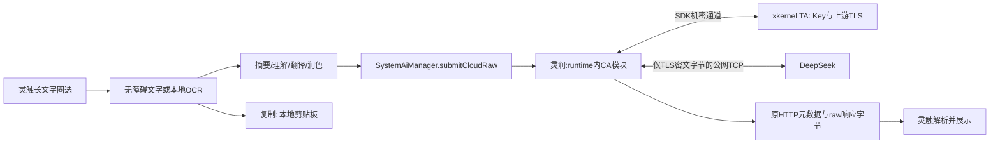

# 灵触—灵润—xkernel 当日MVP实现设计 v0.5

日期：2026-11-13。当前执行入口；配套[MVP需求](mvp-requirements-v0.5.md)。先完成单路真实闭环，保留并发扩展，不继续扩大全量产品设计。本文明确覆盖v0.4的部署方式和当日范围，CA—TA的LSP/1字段/错误/所有权合同继续沿用。

## 1 唯一目标链路

灵触继续生成原AiRequest：scene=`lingchu.action.raw`、requestedModel=`auto`、SYSTEM/USER消息、cloudAllowed=true、privacy=0。模型由灵润全局设置固定为官方DeepSeek的deepseek-flash。CA/TA不理解“摘要/翻译”菜单，只接管同一Chat请求的认证、传输和正确终止。

灵触当前UI会拒绝上一任务未结束时再次圈选；它不是双并发展示入口。raw网络按SSE传输，现有UI聚合完成后才显示，本MVP不改成逐字展示。

## 2 今天双方的责任边界

| CA与灵润同事 | TA负责人 |
| --- | --- |
| 灵润APK/:runtime内native模块、SDK封装、请求位、取消与TCP转发 | 新secret-teeproxy-ta仓库的TA实现，复用可用的旧TLS/存储代码 |
| provider的TA引用元数据、Key预设/迁移、设置界面兼容 | Key持久化及引用/版本/receipt、白名单、认证注入 |
| Chat body编码、输出预算映射、raw Listener与最小Observer | 每个请求独立TLS/HTTP状态、有界STEP、终态和存储错误 |
| 同签名APK构建更新、正常SystemAiManager测试客户端 | 专用调试xkernel/rootfs/manager组合、启动与持久盘、TA装载 |
| SDK连接使用实际CID/端口；不把Key放进普通请求 | 保持冻结kernel.bin，不接管Android系统HAL |

共同输入为[LSP/1](contracts/ca-ta-protocol-v1-draft.md)、[注册表](contracts/lsp-v1-contract-registry.json)、[metadata schema](contracts/lsp-v1-metadata.schema.json)及样例。TA新仓库：`https://github.com/TomGoh/secret-teeproxy-ta`，本地`secret-teeproxy-ta/`。旧secret-teeproxy-ca可复用库层，但其server/CLI不成为生产CA服务；旧TA协议不能悄悄替代LSP/1，若实现发现必要差异先同步双方合同。

## 3 MVP接口与运行初值

- LSP/1.0，TA UUID `c86d23b9-e568-509e-a9b2-0ad40668caf5`，GP CMD `0x1000`，ParamTypes `0x0265`。
- 64B固定头，p0完整帧≤16384B，p1预留32768B，JSON≤4096B；TA入口p1容量按选定SDK从values.a读取，实际回复写data并核对p2/frame长度。
- 管理命令HELLO/PUT/QUERY/DELETE及请求OPEN/BODY_CHUNK/COMMIT/STEP/FINISH/CANCEL/STATUS沿用既定字段。MVP provider只开放CHAT与MODELS；其它操作明确拒绝，不启用旧直连兜底。
- CID由AVF实际分配，不沿用旧注册表中的201示例。项目manager端口10099；先检查监听冲突，CA通过本次endpoint配置和HELLO核对目标。
- CA与TA分别执行单活跃生成限制，HELLO如实报告1。每项操作有独立句柄/上下文，超额E_BUSY；管理先串行，不能另开管理会话覆盖正在执行的全局relay。
- 暂存与帧预算沿用详细合同，不在今日更换为新流式上传协议。只实现一条有界真实路径；无界队列、无限重试、错误当EOF成功都不能保留。

CA内部JNI可以按现有团队封装实现，详细C ABI/票据草案是参考；不可改变跨团队的LSP、缓冲所有权、取消/真实清理条件和APK内形态。并发扩展需要的请求标识、session/epoch、容量协商和独立状态今天保留；完整多路调度/压力与并发更新不作为当日验收门槛。

## 4 灵润接入点和无旁路

主接入点为`KylinCloudInferenceRuntime.generateRawBlocking()`的customProvider分支：当前这里读Android Key、组装认证并使用HttpsURLConnection。改为：

1. 根据已选provider解析固定profile与key_ref/version，复用现有消息编码产生不带认证头的UTF-8 Chat JSON。
2. CA提交引用与body给TA；TA验证目标/profile、取得Key并构造认证、完成上游TLS。
3. CA仅连接TA给定目标并发送NET_TX，收取密文交STEP；HTTP_HEAD/BODY按原raw回调顺序返回。
4. 最小Chat Observer检查完整SSE结束及finish_reason；成功必须同时满足协议完成、HTTP/所选终止策略与交付栅栏。提前EOF/网络失败不能发“完整成功”。不改写正常raw正文。

原raw合同文本“仅内置麒麟云”已与实现漂移；先在本设计说明，**不要为了改一句注释单独改变已安装Framework的契约哈希**。保留公开包名、Binder方法顺序与hash兼容，后续统一升级文档/Framework时再整理。

同一个受保护provider的普通generateBlocking、模型目录查询等入口不得继续读取旧Key直连：复用同一TeeProviderExecutor，暂不支持的入口明确不可用。`system_ai_raw=false`不是降级选项。TA/SDK不可用时明确失败，不从Android凭证副本恢复请求。

Chat输出预算需要CA侧同事补上实际编码映射并以发包fixture/上游行为验证：现代码会忽略App的max_output_tokens，不能把500/900/1200/1600当已生效。图片/文件编码暂不纳入主演示；不向当前屏幕自动取图上传。

## 5 Key预设和现有配置迁移

保留系统设置现有provider编辑入口。新录入Key只在输入/导入阶段经CA传TA；成功后Android保留profile、key_ref、version、托管标记与非秘密receipt。正常请求不再获得明文Key。

设备现有DeepSeek Key仍在旧存储中。开发时明确执行一次迁移：服务内读取已有值→TA PUT→QUERY/receipt确认→原子保存引用和`TEE_REQUIRED`标记→清理本provider旧密文记录。任一步失败不宣称迁移成功，不先删原值；结果未知只QUERY对账。不要导出Key到shell、日志、源码或host文件。不要删除可能被其它provider共用的AndroidKeyStore总alias。

迁移完成后禁止回退读旧Key。回装旧APK可能不认识TA引用，必要时需用户重新录入Key；不能为回退而另存一份真实Key。备份只包含原APK、非秘密配置和产物清单，不备份整份含凭证的应用数据。

TA使用持久存储；内存临时凭证只用于保存前测试，不能作为持久托管的最终替代。普通重启保留本项目instance/data，严禁遇错自动清盘。底层安全性由xkernel服务提供；本项目负责正确使用和验证引用、落盘结果与无旁路。

## 6 .18 独立调试VM，先不改系统分区

已读证据显示`.18`为普通pd2508，AVF报告支持protected VM、shell具备自定义VM权限、当前无运行VM。优先使用已有`/apex/com.android.virt/bin/vm run`，不是不存在的run-raw子命令；首个功能探针one_cpu、1024MiB，公网上行在CA，不给TA额外TAP/桥接网络。

kernel使用已冻结`.19`字节SHA256 `7acf3cb1b1b8826b96ec78e14292b60c509fb87cbcf1d83e4dc50a6ac1fcc5f1`。在`/data/local/tmp/lsp-magictouch-mvp-20261113/`建立本项目独立kernel/rootfs/instance/data；不引用或删除`.19`运行盘，也不占用`.18 /metadata`。

盘序按已核对模板：vda为vm-instance组合盘，vdb为rootfs只读副本，vdc为本项目新可写数据盘。instance为新文件并按已知魔数/版本初始化，不能简单全零。data在首次离线制作时格式化为兼容ext4，固定UUID；不能把报告中的truncate空文件示例当作已经可持久化，也不能保留旧脚本“挂载失败就mkfs”的自动清盘分支。

GP后端固定/tee，rootfs需把可写GP数据映射到新data盘，并保留规范/tee/ta路径和只读项目代码视图。专用VM只启用本项目所需服务，暂不运行无关biometrics等负载，不向Android注册KeyMint/Gatekeeper accessor。若启动/挂载不兼容，停止此项目候选并保留日志；不关闭protected或替换系统固件来伪称通过。

vm CLI没有daemonize。按[调试部署草案](../../artifacts/magictouch-mvp-audit-20261113-103809/debug-vm-and-apk-plan.md)由nohup/setsid保持独立owner和console FIFO；**实际断开ADB后的保活必须验证**，不能只看shell启动成功。使用本次实际CID，不写死201。确需CLI未暴露的固件/实例参数时才补最小AVF调试runner；它只控制VM，不是CA代理。

专用VM的恢复先采用明确归属下的显式停止/重启，保留磁盘且不重放在途生成。完整v0.4共享系统VM supervisor工程后置；业务取消、单请求清理和无旁路仍必须。此轮只有能力/配置/语法核对，尚未真正启动候选VM。

## 7 替换APK并保留系统设置入口

包名保持`com.kylinos.magicsmoothservice`；设置action仍为`com.kylinos.systemai.action.SYSTEM_AI_SETTINGS`，Activity仍为`.settings.SystemAiSettingsActivity`。公开Framework 2.1.0与Binder契约、签名权限和灵触客户端不改。JNI库随APK进入:runtime，不通过外部CA进程工作。

使用与预装包相同的开发签名、非降低versionCode，首选`adb install -r`作为/data上的系统App更新，不直接覆盖/system。预装灵润与compiler现有platform公开证书摘要已核对相同；签名私钥留compiler。后续compiler暂时失联，演示前必须提前准备好已签产物，不把现场构建签名作为演示步骤。

更新后必须从用户当前系统设置中的原入口进入，核对provider保留、托管状态、保存/查询，随后验证灵触Binder重连。覆盖安装会结束旧进程，要在无在途请求时做；不使用pm clear或普通卸载解决问题。原APK已归档以供同签名回装，Key迁移后的数据兼容边界按上一节处理。

开发APK允许debuggable；以run-as原子写入新的非秘密`files/tee-endpoint.json`（version/cid/port），然后在空闲时重建runtime。文件不包含Key；不读取/导出prefs。演示前固定endpoint，VM重启获得新CID后重新配置。可用debug dump输出TA就绪、key_ref/version、活跃数与错误码，不要求今天增加复杂管理UI或公开新接口。

## 8 今日执行顺序与证据

1. TA侧先完成专用VM真实boot、可写存储和无Key SDK HELLO，锁定SDK/manager/TA组合；这是第一阻断门禁。
2. CA同事并行将接口适配器接入raw分支、加入native库、完成同签名APK与原设置入口替换；先对mock TA测试，不能把mock当Demo。
3. 联调假Key与受控上游，确认认证只在TA填充、响应由TA解密；随后在设备内显式迁移用户Key。
4. 先做一次真实raw短请求，验证HTTP200、文本、finish_reason及[DONE]；不重复用普通submit结果代替。
5. 固定长文字材料，逐项跑摘要/理解/翻译/润色/复制，再做20轮顺序运行、一次忙拒绝、一次取消/恢复、一次专用VM停/起后原引用复用。
6. 演示前固定所有APK/TA/SDK/kernel/rootfs哈希，预检Key引用、endpoint、网络/模型、raw开关与UI菜单；准备一套明确恢复指令，现场不临时升级。

普通submit已经真实返回DeepSeek标记，但多11个null；灵触raw解析有null防护，不能把它直接当本Demo阻断。额外raw测试只编译，因签名所需compiler连接超时未跑；目前没有真实灵触圈选、TEE调用或完整Demo通过证据。

双并发、图片理解、三协议覆盖、全自动系统启动、完整监督恢复和强身份增强均不抢占当前闭环；接口保留扩展，后续按实际需求逐项补测。
